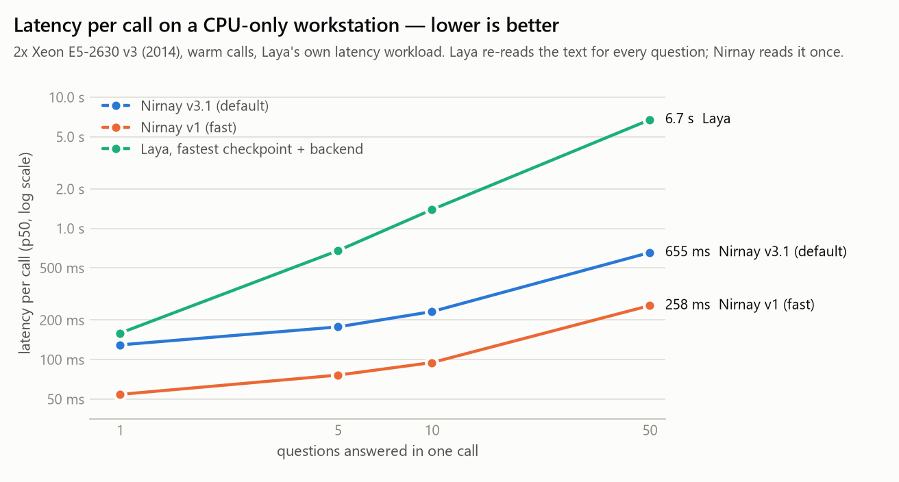

# ⚖️ Nirnay — fast, deterministic decisions on CPU

**Classify, rate and answer yes / no about any text or JSON — with calibrated probabilities, in one pass, no GPU,
no text generation.** Drop-in compatible with the Laya / Jev question format and `/v1/systemone` API.

[](https://huggingface.co/nandukmelath/nirnay)
[](https://colab.research.google.com/github/nandukmelath/nirnay/blob/main/notebooks/nirnay_demo.ipynb)




*Measured on a 2014 dual-Xeon workstation with no GPU, using Laya's own latency workload. Laya re-reads the text for
every question; Nirnay reads it once — 10 questions take 0.23 s instead of 1.4 s, 50 take 0.65 s instead of 6.7 s.*

* **Weights:** [huggingface.co/nandukmelath/nirnay](https://huggingface.co/nandukmelath/nirnay) (v3.1 default, v2 in `v2/`, v1 in `fast/`)
* **Try it free in Colab (CPU runtime):** [notebooks/nirnay_demo.ipynb](https://colab.research.google.com/github/nandukmelath/nirnay/blob/main/notebooks/nirnay_demo.ipynb)

## New in v3.1 (default)

* **Request routing 0.404 → 0.875** ("is this a coding, math, data, writing, factual or small-talk request?"), now
  ahead of every Laya checkpoint (best 0.659); the routing benchmark's own sources (gsm8k, mbpp) stay held out.
* **SMS spam 0.670 → 0.790**, **emotion 0.550 → 0.595**, **toxicity 0.660 → 0.688**, **RAG relevance 0.655 → 0.680**.
* **Against the best of Laya's three checkpoints: 5 wins, 2 ties, 5 losses** (v2: 3 / 1 / 8).
* New training data: request routing (code, math, SQL, writing, trivia, small talk), short-message spam, request
  safety (NVIDIA Aegis 2.0, content-harm wording), urgency asked a dozen ways, 8 more phrasings of every template.
* Trade-offs: jailbreak 0.647 vs v2's 0.695 at the default threshold (ranking AUC 0.701 vs 0.713) and Banking77
  0.598 vs 0.610. An unreleased v3 asked some safety questions about AI-assistant behaviour and learned to call every
  harmful prompt a jailbreak (AUC 0.564); v3.1 asks about content harm only. Details: [REPORT.md](REPORT.md).
* New: [`train/train_gpu.py`](train/train_gpu.py) trains the same model on any CUDA GPU (verified against the CPU
  pipeline: identical answers on 64/64 test questions), and [`jobs/kaggle_gpu.py`](jobs/kaggle_gpu.py) runs it on
  Kaggle's free T4 GPUs.

## Why Nirnay

* **One read per call** — 1 question or 50 questions about the same text cost almost the same.
* **No label limit** — every option is encoded separately: 77-way intent detection beats Laya (0.598 vs ≤0.492),
  and hundreds of labels work.
* **Order-proof and deterministic** — reordering options can never change an answer (flip rate 0.000;
  Laya 0.14–0.19). Repeat calls are byte-identical; no decision changes across 1/4/8/16 CPU threads.
* **Calibrated** — `answer_confidence` is a probability you can gate on.
* **Adapts without training** — `learn()` with 16 examples per label: Banking77 0.598 → **0.840**, on a CPU.
* **Small** — 527 MB (v3.1) or 155 MB (v1, about 2.4x faster again); Laya's checkpoints are 614–804 MB.

## Install

```bash
# the package (pure Python; downloads weights from the Hugging Face Hub on first use)
pip install git+https://github.com/nandukmelath/nirnay

# or the wheel from the Hub, or an editable clone
pip install https://huggingface.co/nandukmelath/nirnay/resolve/main/dist/nirnay-1.0.0-py3-none-any.whl
git clone https://github.com/nandukmelath/nirnay && cd nirnay && pip install -e .
```

Requires Python 3.10+, PyTorch (CPU build is enough), `tokenizers`, `safetensors`, `huggingface_hub`.

## Use

```python
import nirnay

m = nirnay.load("nandukmelath/nirnay")                        # v3.1, most accurate (default)
# m = nirnay.load("nandukmelath/nirnay", subfolder="fast")    # v1, fastest
# m = nirnay.load("nandukmelath/nirnay", subfolder="v2")      # the previous default, pinned

r = m.predict(
    {"ticket": {"subject": "Payout failing", "body": "My payouts failed for 3 days, please help ASAP"}},
    {"team":     {"type": "choice", "instructions": "Which team should handle this?",
                  "criteria": {"billing": "payments", "technical": "bugs and integrations", "sales": "pricing"}},
     "urgent":   {"type": "noul",   "instructions": "Is this ticket urgent?"},
     "severity": {"type": "score",  "instructions": "How severe is the problem?",
                  "criteria": ["minor", "moderate", "severe"]}})

r["answers"]["team"]["choice"]        # 'billing'
r["answers"]["urgent"]["noul"]        # P(yes)
r["answers"]["severity"]["score"]     # expected level 0..2

m.predict_batch(states, questions)                              # many texts, same questions
m.learn("team", questions["team"], [(text, "billing"), ...])    # few-shot memory, no training
```

Question types: `choice` (pick one of N labels, `criteria` = `{label: description}` or a list), `score` (ordinal,
`criteria` = levels low → high), `noul` (yes / no → P(yes)). Every answer carries `probabilities`, `confidence` and
`answer_confidence`; pass `min_confidence=` to get an `abstained` flag.

| interface | command |
|---|---|
| HTTP server (Jev / Laya wire format) | `python -m nirnay.server --port 8000` → `POST /v1/systemone`, `/v1/systemone/batch` |
| MCP server for local agents | `python -m nirnay.mcp_server` (tools `decide`, `classify`, `yes_no`) |
| Command line | `nirnay "text" --choice "billing,technical,sales" --ask "Which team?"` |
| Windows one-click launcher | `RUN.bat demo` / `serve` / `mcp` / `bench` / `test` |

## How it works

```
state (text / JSON)        question "<type> question: <instructions>"       options "<label>: <description>"
       |                               |                                            |
 encoder layers 1-8 (frozen) — every text encoded on its own; question/option results cached per schema
       |                               |                                            |
 encoder layers 9-12 (trained copies) over [ state ; questions ; options ] with an asymmetric mask:
     state rows    attend to the state only          -> computed ONCE per call, shared by every question
     question rows attend to state + own question
     option rows   attend to state + their question + own option   (never to other options)
       |
 score at each option's first token + learned cosine prior -> softmax over options -> per-bucket temperature
```

The top of the network is a cross-encoder (option tokens read the state at every layer), but the state never reads
the questions — so one state encoding serves every question, and options are independent of each other. Training
minimises strictly proper scoring rules (log score, plus ranked probability score for ratings) with exact gradients.
Layers 1-8 are frozen and pre-computed once, so only the top 4 layers + scorer train (29M parameters): v3.1
(bge-base) continued from v2 for 1.25 epochs on 324k typed questions on a CPU (two sockets, data-parallel, ~9 hours).

## Benchmarks

Laya (`laya` 0.4.14 from PyPI, all three checkpoints, its own API and calibration) ran on the same machine on
byte-identical cases: the 400-case suites of Laya's own application benchmark (seed 13) plus two held-out extras.
Jev is a closed cloud API, so its column is the published third-party figure.

| task | **Nirnay v3.1** | Nirnay v2 | Nirnay v1 | Laya en | Laya ml | Laya td | Jev (published) |
|---|---|---|---|---|---|---|---|
| AG News (4 topics) | 0.925 | 0.925 | 0.882 | 0.950 | 0.935 | **0.953** | 0.910 |
| DAIR emotion (6) | 0.595 | 0.550 | 0.515 | 0.593 | 0.537 | **0.600** | 0.480 |
| Banking77 (77 intents) | 0.598 | **0.610** | 0.595 | 0.425 | 0.470 | 0.492 | 0.870 (72 labels, n=100) |
| support triage (10 queues) | 0.407 | 0.415 | 0.417 | 0.502 | **0.540** | 0.505 | — |
| Enron spam | 0.995 | 0.995 | 0.968 | **0.998** | **0.998** | 0.968 | — |
| phishing | 0.973 | 0.975 | 0.948 | 0.980 | **0.993** | 0.940 | — |
| jailbreak (toxic-chat) | 0.647 | 0.695 | 0.787 | 0.708 | **0.805** | 0.762 | — |
| toxicity (toxic-chat) | **0.688** | 0.660 | 0.595 | 0.530 | 0.535 | 0.530 | — |
| RAG passage relevance | **0.680** | 0.655 | 0.613 | 0.625 | 0.672 | 0.625 | — |
| model routing (domain) | **0.875** | 0.404 | 0.446 | 0.639 | 0.441 | 0.659 | — |
| SST-5 (5-level rating) | 0.490 | **0.492** | 0.425 | 0.352 | 0.292 | 0.470 | — |
| SMS spam | 0.790 | 0.670 | 0.600 | **0.938** | 0.807 | 0.910 | 0.930 (independent) |

**Honest summary:** against the best of Laya's three checkpoints (picked per task, after the fact) Nirnay v3.1 wins
5 tasks (Banking77, toxicity, RAG relevance, model routing, SST-5), ties 2 (emotion, Enron spam) and loses 5 (AG
News, support triage, phishing, jailbreak, SMS spam); against Laya's default English checkpoint it is also 5 / 2 / 5.
It beats Jev's published AG News and emotion figures. Laya is a 421M-parameter model fully fine-tuned on GPUs; Nirnay
trains 29M parameters on a CPU.

| speed (warm p50) | 1 question | 10 questions | 50 questions |
|---|---|---|---|
| **Nirnay v3.1** | 129 ms | 232 ms | 655 ms |
| Nirnay v1 | 54 ms | 95 ms | 258 ms |
| Laya at its fastest (any checkpoint, eager or its ONNX backend) | 159 ms | 1,389 ms | 6,730 ms |

Every measurement (calibration, determinism, footprint, few-shot, ablations): [REPORT.md](REPORT.md); raw results in
[`bench/results/`](bench/results).

## Reproduce

```bash
python bench/suites.py                      # rebuild the 12 benchmark suites (Laya's cases + 2 held-out extras)
python train/build_data.py                  # typed-question training corpus from public datasets
python train/precompute.py                  # frozen encoder over every unique text (keeps layer-8 states)
python train/train_head.py                  # train + calibrate + export (NIRNAY_FUSION=deep NIRNAY_SPLIT=8)
python train/train_gpu.py                   # or: the same model on a CUDA GPU, no precompute step
python jobs/kaggle_gpu.py                   # or: on Kaggle's free T4 x2 (after `kaggle auth login`)
python bench/eval_suites.py nirnay:models/nirnay-v31      # accuracy, calibration, order-flip, determinism
python bench/suites_multi.py                # MASSIVE (51 languages) + SIB-200 (205 languages) suites
python bench/eval_suites.py laya:laya                     # the same for Laya (pip install laya)
python bench/bench_latency_nirnay.py && python bench/bench_latency_laya.py
python bench/report.py                      # REPORT.md
```

`jobs/v31.cmd` is the exact two-socket pipeline that produced v3.1 (`jobs/overnight.cmd` produced v2; Windows);
`docs/WORKSTATION_GUIDE.md` covers
the workstation setup. Environment variables of each script are documented at its top.

## Limitations

* English only (bge-*-en backbones); a multilingual Nirnay is in training.
* Wording still matters for concepts it rarely trained on. v3.1 learned urgency from a dozen phrasings: on a small
  check "Does the customer express urgency?" gets 6 of 8 tickets right (v2: 4 of 8). Probabilities rank texts well
  even when a phrasing moves the yes/no threshold; fix the threshold with a few labelled examples via `learn()`.
* Jailbreak detection is zero-shot (jailbreak data is held out, as Laya does) and not a strength: at the default
  threshold v3.1 over-flags some harmful but non-jailbreak prompts.
* It decides; it does not reason step by step or write text.
* Calibration is fitted on the training mixture; refit (or use `learn()`) on your own traffic before automated gating.

## Repository layout

| path | what |
|---|---|
| `nirnay/` | the package: encoder, deep-fusion head, engine, few-shot memory, HTTP / MCP servers, CLI |
| `train/` | data builder, encoder precompute, CPU training (single process or DDP), GPU training, encoder bake-off |
| `bench/` | benchmark suites (incl. MASSIVE + SIB-200), Laya/Nirnay evaluation, latency, determinism, few-shot, report |
| `kaggle/`, `jobs/` | the Kaggle GPU job and its driver; the exact Windows pipelines that produced each model |
| `notebooks/` | the Colab demo |
| `hf_space/` | a Gradio demo app: run it locally with `pip install gradio` and `python hf_space/app.py` (hosting it as a Hugging Face Space needs a PRO plan) |
| `tools/` | chart generation |
| `tests/` | invariants: encoder parity with transformers, option-order invariance, rendering, routing |

## Training data and license

Public datasets (listed in [`train/build_data.py`](train/build_data.py) and on the model card), converted to typed
questions. Held out of training, mirroring Laya's own policy: dair-ai/emotion, mteb/banking77, lmsys/toxic-chat,
gsm8k / mbpp, SetFit/sst5, ucirvine/sms_spam (and any text matching it), XNLI, MASSIVE, SIB-200 and all jailbreak /
prompt-injection datasets; any text appearing in a benchmark case was removed by exact match. v3.1 adds CodeAlpaca,
HumanEval, SVAMP, AQuA-RAT, MATH, sql-create-context, Gretel text-to-SQL, WritingPrompts, Dolly 15k, NQ-Open, SODA,
India SMS spam and NVIDIA Aegis 2.0 (licences on the model card).

Code and weights: Apache-2.0. Some training datasets carry research-only or non-commercial terms (for example MS MARCO,
RACE, Yahoo Answers, Yelp reviews, Quora question pairs); check them before commercial use.

Built on [BAAI/bge-base-en-v1.5](https://huggingface.co/BAAI/bge-base-en-v1.5) and
[BAAI/bge-small-en-v1.5](https://huggingface.co/BAAI/bge-small-en-v1.5) (MIT). The benchmark cases reproduce the
application benchmark of [Laya](https://huggingface.co/convaiinnovations/laya) ([source](https://github.com/NandhaKishorM/laya))
by Nandakishor M (Convai Innovations), whose open model inspired this project.
